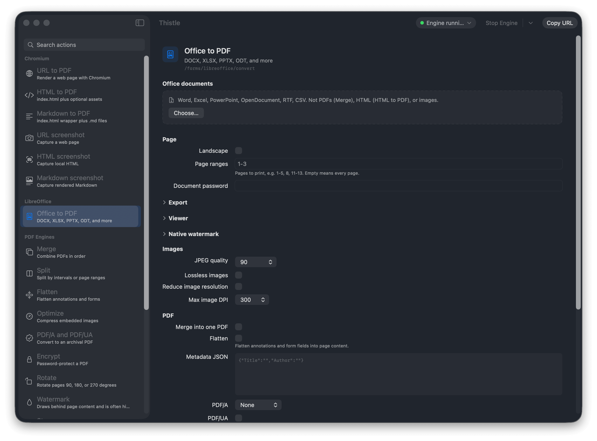
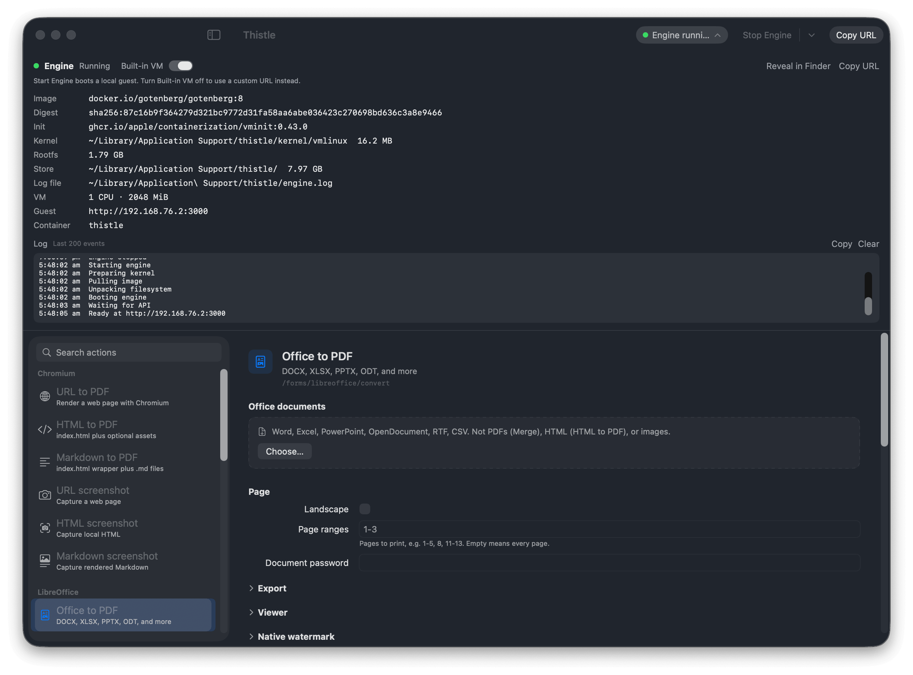

# thistle

A Mac app that talks to [Gotenberg](https://gotenberg.dev). It can boot the full Gotenberg image on Apple silicon in a built-in VM, or send requests to a Gotenberg API you already run.



The window is a client. A per-user LaunchAgent owns the VM. Launch does not boot the guest. **Start Engine** (or the first convert) registers the agent, pulls `linux/arm64` if needed, boots the container, and waits for `/health`. Quitting the window leaves the engine running. **Stop Engine** tears the VM down. After 15 minutes idle the agent stops the guest and deletes the writable layer.

One GUI instance. One CPU guest. A second launch brings the existing window forward.

## Requirements

- Mac with Apple silicon
- macOS 26
- Xcode 26 / Swift 6.2

## Install

Download the zip from [latest](https://github.com/sukujgrg/thistle/releases/latest). Unzip it and copy `Thistle.app` to `/Applications` or `~/Applications`.

## Build and run

```bash
make run
```

That builds `bin/Thistle.app` with `ThistleEngine` inside, signs the helper with `com.apple.security.virtualization`, and opens the GUI. Enable **Thistle Engine** in System Settings > General > Login Items if macOS asks.

Local builds use an installed Developer ID Application or Apple Development signing identity when available, so macOS can retain Local Network permission across rebuilds. To choose a certificate, pass `SIGNING_IDENTITY="Apple Development: Your Name (TEAMID)"`. Without a certificate the build falls back to ad-hoc signing, which may require granting permission again after a rebuild.

The built-in VM is reached over a local network interface. Allow **Thistle** when macOS asks for Local Network access. If a start reports that local-network access is blocked, open System Settings > Privacy & Security > Local Network, enable Thistle, and start the engine again. The LaunchAgent is associated with Thistle so the permission belongs to the app.

`make build` installs a release configuration app into `~/Applications`. For distribution, update `VERSION`, commit and push to `main`, then run `make release`. The ViewTheWord/eucaly release flow validates CI, signs, notarizes, tags, and publishes automatically. See [MAINTAINERS.md](MAINTAINERS.md) for setup and recovery. The app checks GitHub for a newer notarized zip and can replace itself from **Thistle > Check for Updates...**.

## First start

The first **Start Engine** downloads a Kata arm64 kernel, Apple's `vminit`, and `gotenberg/gotenberg:8` (Chromium, LibreOffice, and PDF engines). Later starts reuse `~/Library/Application Support/thistle/`. Chromium and LibreOffice auto-start so the first conversion is not a cold launch.



The VM uses 1 CPU and 2 GiB of memory. The guest still listens on port 3000. The host address is the vmnet IPv4. Copy it from the toolbar if another client should call the same engine.

The **Start Engine** control is a split button. The menu has **Restart**, **Refresh Image** (pull a new digest and rebuild the rootfs), and **Reset** (delete downloaded engine data, temporary jobs, and logs while keeping settings). Those actions open the engine banner so the log stays visible.

The inspector has a **Built-in VM** toggle. Off uses a custom Gotenberg URL (for example `http://127.0.0.1:3000`) and stops the guest if it is running. Connect the URL, then conversions go to that API. Turning **Built-in VM** on again returns to the local engine; **Start Engine** then boots the guest.

The inspector shows the running Gotenberg version for both built-in and custom engines. **Check for engine updates** checks the latest stable upstream release and links its release notes. When an update is available for the built-in engine, **Refresh Image** downloads it. Actions explain when a selected feature requires a newer engine. Custom servers without a version endpoint remain usable, with compatibility shown as unknown.

Custom servers support **None**, **Basic**, and **Bearer token** authentication. Enter a username and password or an existing bearer token, then **Connect** to apply and save it in macOS Keychain. Credentials are scoped to the API URL, kept out of settings and request logs, and used for health checks, version checks, and conversions. Editing the URL or authentication requires connecting again. Selecting **None** and connecting removes the saved credentials for that URL.

## Actions

Pick an action in the sidebar, then run it in the same window:

- **Chromium:** URL, HTML, or Markdown to PDF. URL, HTML, or Markdown screenshots.
- **LibreOffice:** Office documents to PDF.
- **PDF engines:** merge, split, flatten, optimize, PDF/A, encrypt, rotate, watermark, stamp, metadata, bookmarks, embed, Factur-X.

JSON routes (read metadata, read bookmarks) show the result in the window. Binary routes keep the converted file and show an in-window preview. **Quick Look** opens a larger preview. **Show in Finder** and **Save As** stay available. After a successful run the form is hidden; **New** brings it back with the same files and options. Save As starts in the source file's folder when there is one, otherwise the last folder you used.

**Stamp** and **Watermark** accept an ordered list of text, image, or PDF marks. Add, remove, or move marks up and down; each has its own page selection and options JSON. Image/PDF marks may reuse the same source file. Multiple marks require Gotenberg 8.36.0 or later; a single mark remains compatible with 8.28.0 and later.

## Notes

- Intel Macs and Rosetta are not supported.
- No App Store sandbox. Developer ID plus the virtualization entitlement on the helper is enough to distribute.
- The guest cannot bind port 0. The VM IPv4 is the ephemeral part.
- A previous LibreOffice-only rootfs in Application Support is unused. The full image unpacks to its own cache file.

## License

[MIT](LICENSE)
