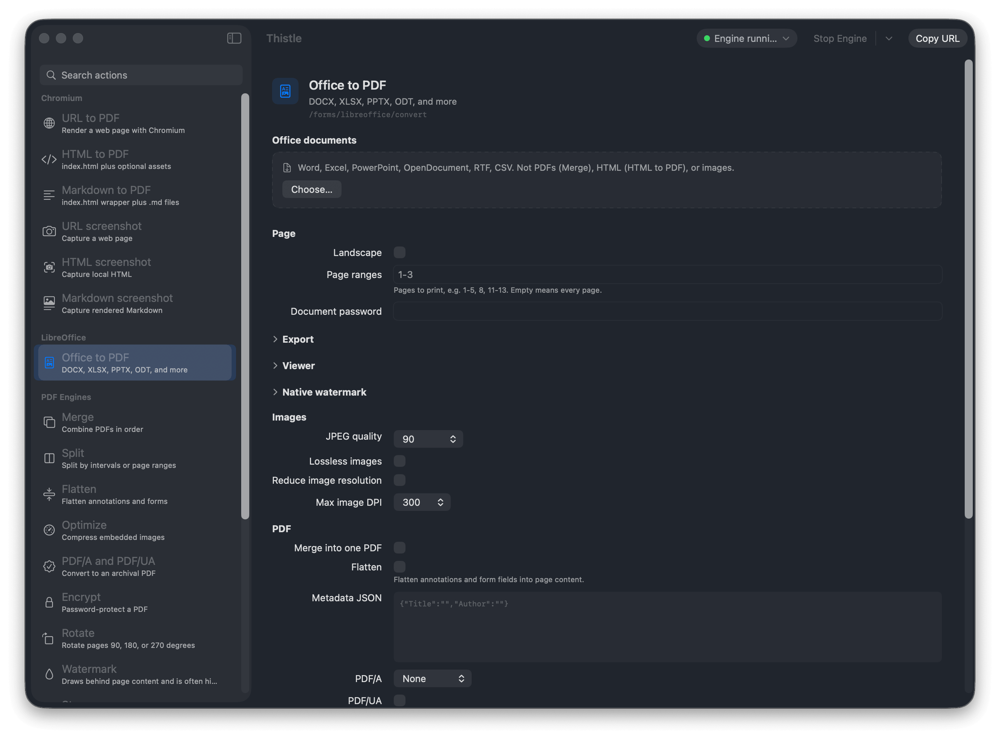
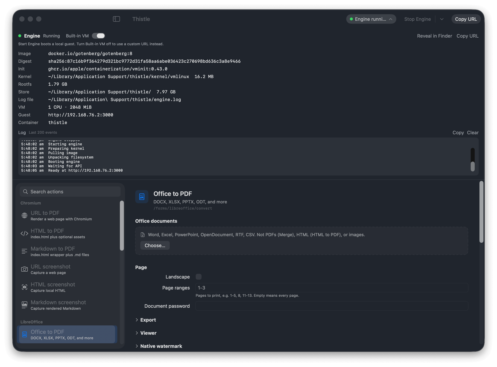

# thistle

A Mac app that talks to [Gotenberg](https://gotenberg.dev) **9**. It can boot the full Gotenberg image on Apple silicon in a built-in VM, or send requests to a Gotenberg API you already run.



The window is a client. A per-user LaunchAgent owns the VM. Launch does not boot the guest. **Start Engine** (or the first convert) registers the agent, pulls `linux/arm64` if needed, boots the container, and waits for `/health`. Quitting the window leaves the engine running. **Stop Engine** tears the VM down. After 15 minutes idle the agent stops the guest and deletes the writable layer.

One GUI instance. One CPU guest. A second launch brings the existing window forward.

## Requirements

- Mac with Apple silicon
- macOS 26
- Xcode 26 / Swift 6.2
- Gotenberg 9 (built-in image or custom API)

## Install

Download the zip from [latest](https://github.com/sukujgrg/thistle/releases/latest). Unzip it and copy `Thistle.app` to `/Applications` or `~/Applications`.

## Build and run

```bash
make run
```

That builds `bin/Thistle.app` with `ThistleEngine` inside, signs the helper with `com.apple.security.virtualization`, and opens the GUI. Enable **Thistle Engine** in System Settings > General > Login Items if macOS asks.

Local builds use an installed Developer ID Application or Apple Development signing identity when available. To choose a certificate, pass `SIGNING_IDENTITY="Apple Development: Your Name (TEAMID)"`. Without a certificate the build falls back to ad-hoc signing.

The built-in API is published on **`http://127.0.0.1:18765`** by default. ThistleEngine bridges that loopback port to Gotenberg inside the guest over vsock, so built-in start and converts do not need Local Network permission. Guest egress still uses vmnet (for URL→PDF). If 18765 is already taken, pick another port in the engine inspector **Advanced** settings (suggestions: 18766, 18767, 28765). Build the guest forwarder with `make guest-forwarder` (Docker, linux/arm64); `make app` installs it into the bundle.

If you point a **custom** engine URL at a LAN host, macOS may ask for Local Network access for **Thistle**.

`make build` installs a release configuration app into `~/Applications`. For distribution, update `VERSION`, commit and push to `main`, then run `make release`. The ViewTheWord/eucaly release flow validates CI, signs, notarizes, tags, and publishes automatically. See [MAINTAINERS.md](MAINTAINERS.md) for setup and recovery. The app checks GitHub for a newer notarized zip and can replace itself from **Thistle > Check for Updates...**.

## First start

The first **Start Engine** downloads a Kata arm64 kernel, Apple's `vminit`, and `gotenberg/gotenberg:9.5.0` (Chromium, LibreOffice, and the litho PDF engine). Later starts reuse `~/Library/Application Support/thistle/`. Chromium and LibreOffice auto-start so the first conversion is not a cold launch.



The VM uses 1 CPU and 2 GiB of memory. Gotenberg listens on guest port 3000; the host Local API defaults to `http://127.0.0.1:18765` (changeable under Advanced). Copy that from the toolbar if another client on this Mac should call the same engine.

The **Start Engine** control is a split button. The menu has **Restart**, **Refresh Image** (pull a new digest and rebuild the rootfs), and **Reset** (delete downloaded engine data, temporary jobs, and logs while keeping settings). Status shows a spinner while those run; open the engine inspector from the status control when you want the log.

The inspector has a **Built-in VM** toggle. Off uses a custom Gotenberg URL (for example `http://127.0.0.1:3000`) and stops the guest if it is running. Connect the URL, then conversions go to that API. Turning **Built-in VM** on again returns to the local engine; **Start Engine** then boots the guest.

The inspector shows the running Gotenberg version for both built-in and custom engines. **Check for engine updates** checks the latest stable upstream release and links its release notes. When an update is available for the built-in engine, **Refresh Image** downloads it. Connected engines below major 9 are blocked. Custom servers without a version endpoint remain usable.

Custom servers support **None**, **Basic**, and **Bearer token** authentication. Enter a username and password or an existing bearer token, then **Connect** to apply and save it in macOS Keychain. Credentials are scoped to the API URL, kept out of settings and request logs, and used for health checks, version checks, and conversions. Editing the URL or authentication requires connecting again. Selecting **None** and connecting removes the saved credentials for that URL.

## Actions

Pick an action in the sidebar, then run it in the same window:

- **Chromium:** URL, HTML, or Markdown to PDF. URL, HTML, or Markdown screenshots. PDF converts include an **After conversion** panel (merge, split, remediate, optimize, encrypt, metadata) encoded as Gotenberg `stages`.
- **LibreOffice:** Office documents to PDF, with the same after-conversion stages.
- **PDF:** merge, split, select, delete, insert, compose, flatten form, flatten transparency, convert colors, optimize, remediate (PDF/A, PDF/UA, Factur-X), validate, encrypt, decrypt, rotate, stamp, metadata, bookmarks, attach, detach, extract text/attachments, fill form, redact, autotag, sign, timestamp, render.

JSON routes show the result in the window. Binary routes keep the converted file and show an in-window preview. Remediation responses surface residual and rolled-back counts when Gotenberg returns them. **Quick Look** opens a larger preview. **Show in Finder** and **Save As** stay available. After a successful run the form is hidden; **New** brings it back with the same files and options. Save As starts in the source file's folder when there is one, otherwise the last folder you used.

**Stamp** draws ordered text, image, or PDF marks over pages via `/forms/pdf/pipe`. Position is in points from the bottom-left of the page; fonts are the 14 standard PDF fonts (other scripts use installed fonts in the image).

## Breaking changes in 1.0

- Gotenberg 8 APIs are not supported. Built-in image is pinned to `gotenberg/gotenberg:9.5.0`.
- PDF routes use `/forms/pdf/…` (not `/forms/pdfengines/…`).
- Watermark is removed; use Stamp (always drawn over page content).
- Metadata write uses the eight standard info fields, not arbitrary ExifTool tags.
- Convert finishing is an explicit stages panel, not flat Gotenberg 8 post-process fields.

## Notes

- Intel Macs and Rosetta are not supported.
- No App Store sandbox. Developer ID plus the virtualization entitlement on the helper is enough to distribute.
- Built-in host API traffic uses loopback (`127.0.0.1`, default port 18765) over vsock; vmnet is for guest egress only.
- A previous LibreOffice-only rootfs in Application Support is unused. The full image unpacks to its own cache file.

## License

[MIT](LICENSE)
